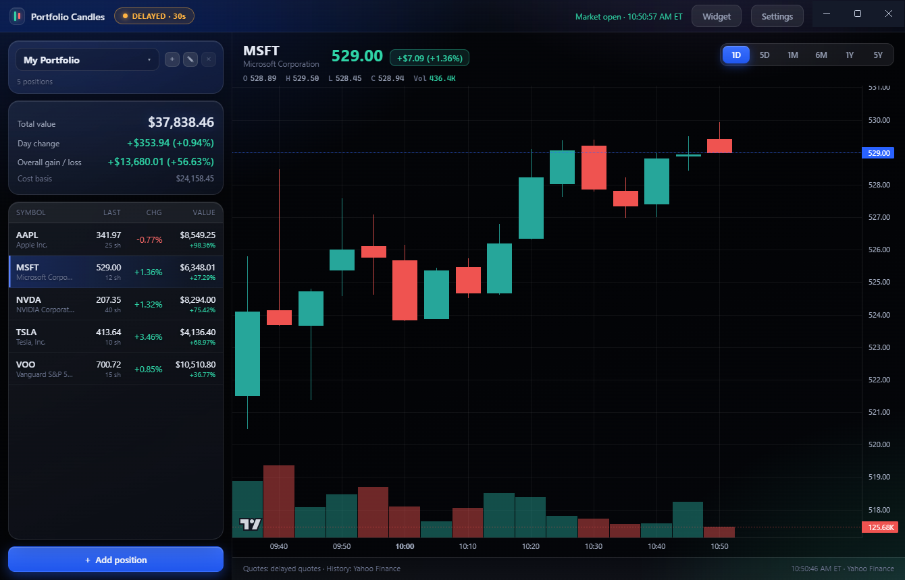

# Portfolio Candles

A Windows desktop app that draws your portfolio as live candlestick charts.

**Download:** [Releases](../../releases)



## Features

- Live candlestick charts with volume, crosshair OHLC, zoom and pan, timeframes from 1D to 5Y
- Multiple portfolios: create, rename, switch, and delete them, all saved automatically
- Positions by shares and average cost, or by plain dollar amount
- Desktop widget: a slim glass panel docked behind every window, showing your totals and positions
- Acrylic glass theme, tray icon with portfolio values, fullscreen (F11), start with Windows
- Three data modes: live (free Finnhub key), delayed (Yahoo Finance, 30s), or demo

## Install

Grab **`Portfolio Candles Setup <version>.exe`** from the Releases page and run it. No admin rights needed. Windows SmartScreen may warn on first run: choose **More info → Run anyway**.

To build from source (Node.js 18+):

```powershell
npm install
npm start        # run the app
npm run dist     # build the installer into dist/
```

If npm blocks Electron's install script, run `npm install-scripts approve electron; node node_modules/electron/install.js`.

For real-time prices, paste a free [Finnhub](https://finnhub.io/register) API key in Settings.

Data lives in `%APPDATA%\Portfolio Candles\`.

## Tech Stack

- [Electron](https://www.electronjs.org/)
- [Lightweight Charts](https://www.tradingview.com/lightweight-charts/)
- [electron-builder](https://www.electron.build/)
